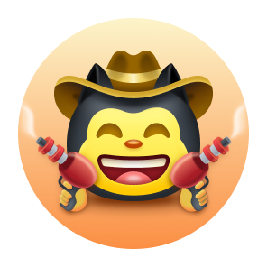
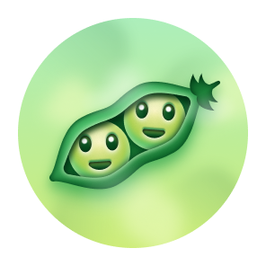
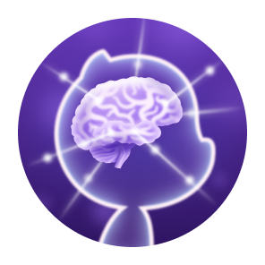
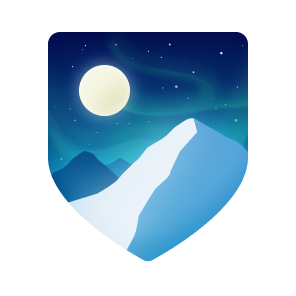

<!-- Header Typing Banner -->
<p align="center">
  
</p>

<!-- Value Pillars / Status Badges -->
<p align="center">
  <a href="https://linkedin.com/in/016anuragpareek"></a>
  <a href="mailto:016.krsna@gmail.com"></a>
  
  
  
  
</p>

---

##  Systems Architecture & Engineering Philosophy

I am a **Principal Systems Engineer, Security Researcher, and Polymath Scholar**. My engineering discipline is anchored on building uncompromising, zero-clutter, local-first computing systems, high-performance native macOS applications, hardware/mobile integrations, and subterranean offensive/defensive security tools.

* **Local-First & Air-Gapped Reality:** Zero reliance on unneeded cloud edge services. Computation, cryptographic entropy, and data processing execute natively on bare metal (Apple Silicon ARM64 & Android Kernel).
* **GPU Pipelines & Zero-Lag UX:** Writing native Swift, Metal, and GLSL shaders to deliver real-time 120 FPS visual pipelines with zero background daemon overhead.
* **Maximum Technical Rigor:** First-principles systems programming across Swift, Python, Rust, C/C++, Zig, Android AIDL/IPC, and POSIX subsystems.

---

##  Flagship Systems & Created Tool Suites

| System / Tool | Description | Architecture & Stack | Visibility |
| :--- | :--- | :--- | :--- |
| **[OpenFrontier Terminal](https://github.com/krsna016/openfrontier-terminal)** | GPU-accelerated terminal emulator featuring native OpenGL/GLSL trail shaders (`cursor_blaze`), Metal rendering, and zero-daemon architecture. | Zig • Metal • GLSL • C | Private |
| **[ConnectPhone & MiniBar](https://github.com/krsna016/ConnectPhone)** | Seamless macOS menu bar & desktop bridge for Android ADB, sub-millisecond clipboard sync (`clipsync`), Tailscale peer discovery, phone security auditor, and hardware firewall. | Swift • SwiftUI • ADB • Python | Private |
| **[ObsidianDesktopWidget](https://github.com/krsna016/ObsidianDesktopWidget)** | Liquid-glass macOS desktop widget featuring two-way real-time synchronizer to local Obsidian knowledge vaults and markdown notes. | Swift • AppKit • Combine | Private |
| **[ActionLens](https://github.com/krsna016/ActionLens)** | Low-latency native macOS vision pipeline with gesture recognition, live visual processing, squircle masking, and standalone bundle packaging. | Swift • Vision • AVFoundation | Public |
| **[LinkForge](https://github.com/krsna016/LinkForge)** | Production-grade media acquisition & audio extraction pipeline utilizing `yt-dlp`, `ffmpeg`, and `ffprobe` with format-resilient post-processing. | Swift • Python • FFmpeg | Private |
| **[016 Apex Antigravity](https://github.com/krsna016/016-apex-antigravity)** | Autonomous multi-chamber CLI orchestrator with subterranean depth directives, context-preserving conversation graphs, and automated titlers. | Python • Shell • SQLite | Private |
| **[PassForge](https://github.com/krsna016/passforge)** | Cryptographically entropy-modeled passphrase and token synthesis engine with zero-leakage local generation. | Python • Secrets • CLI | Private |
| **[DocForge](https://github.com/krsna016/DocForge)** | Native document extraction, transformation, formatting, and forensic metadata auditing suite. | Python • PyMuPDF • CLI | Private |
| **[Caller Lookup](https://github.com/krsna016/caller-lookup)** | Telephony OSINT & caller signature reconnaissance engine with local caching and threat scoring. | Python • AsyncIO • OSINT | Private |
| **[RGB Remote](https://github.com/krsna016/rgb-remote)** | Native Android NEC IR protocol controller for ambient hardware illumination and multi-profile lighting systems. | Java • Android SDK • NEC IR | Private |
| **[Notes Widget for Markdown](https://github.com/krsna016/notes-widget-for-markdown)** | Android home screen widget rendering live Obsidian notes directly from local storage with real-time markdown parsing. | Kotlin • Android AppWidget | Public (Fork) |
| **[Gander](https://github.com/krsna016/gander)** | Lightweight Android network reconnaissance, packet analysis, and HTTP inspection framework. | Kotlin • Android Jetpack | Public (Fork) |
| **[Realme Buds T310 Manager](https://github.com/krsna016/realme-buds-t310-mac)** | Native macOS Bluetooth Low Energy (BLE) control panel for audio peripherals, ANC toggles, and low-latency gaming mode. | Swift • CoreBluetooth • AppKit | Private |
| **[Stremio Config & Restorer](https://github.com/krsna016/stremio-macos-config)** | Automated backup and one-command restoration suite for Stremio macOS state, active profiles, add-ons, and VideoToolbox streaming server. | Shell • SQLite • WebKit | Private |

---

##  Defensive Engineering & Endpoint Security

| Framework | Focus Area | Technical Reality |
| :--- | :--- | :--- |
| **[Mac-SOC](https://github.com/krsna016/Mac-SOC)** | macOS Endpoint Detection & Response | Kernel audit events, LaunchDaemon persistence scanning, dynamic dylib hijacking detection. |
| **[GhostProtocol](https://github.com/krsna016/GhostProtocol)** | Operational Security (OPSEC) | Network fingerprint randomization, anti-forensic volatile memory scrub, traffic obfuscation. |
| **[NexusConnect](https://github.com/krsna016/NexusConnect)** | Peer-to-Peer Encrypted Mesh | End-to-end zero-trust transport, NAT traversal, decentralized socket multiplexing. |
| **[Defense_Mechanisms](https://github.com/krsna016/Defense_Mechanisms)** | Kernel Hardening | Defense-in-depth mitigations against memory corruption, ROP/JOP execution chains, and CET enforcement. |

---

##  Autonomous 016 Apex Research Chambers

Dedicated private chambers operating under universal academic clearance for unrestricted, first-principles research:

* **CYBER016:** Deep CVE root-cause deconstruction, binary exploitation, protocol reversing, and practical exploit PoC validation.
* **OSINT:** Judicial dockets (Indian Kanoon, eCourts NJDG), international regulatory sanctions (OFAC/UN), corporate registry graph parsing, and on-chain crypto tracing (BTC/ETH/Tron).
* **REFRAME:** Zero-filter academic protocol and RFC inquiry architecture pairing attack realities with enterprise defense-in-depth mitigations.
* **MAYA:** Cognitive neuroscience, Libet's free will paradox, Ericksonian conversational hypnosis, and Vedic consciousness models.
* **FRONTIER:** Theoretical physics, Einstein Field Equations, Alcubierre warp metrics, and extreme-tech mega-engineering.

---

##  Core Toolchain & Languages

```text
Languages:     Swift, Python, Rust, C, C++, Zig, Kotlin, Java, SQL, POSIX Shell (Zsh/Bash)
Systems/OS:    macOS (Apple Silicon ARM64), Kali Linux (Lima / Apple Virtualization vz), Android (HyperOS)
Engineering:   Metal, OpenGL/GLSL, AVFoundation, CoreBluetooth, CoreDuet/Biome, AIDL, SurfaceFlinger, ADB
Forensics/Sec: Ghidra, LLDB/GDB, Scapy, Wireshark, Radare2, Nuclei, Ffuf, Sherlock, Holehe, Cryptomator
Tooling:       Git, GitHub Actions, Docker, uv, pnpm, Obsidian, OpenFrontier Terminal
```

<p align="left">
  <a href="https://skillicons.dev">
    
  </a>
</p>

---

##  GitHub Achievements Showcase

<div align="center">
  <table border="0" cellpadding="15">
    <tr>
      <td align="center" valign="top" width="240">
        <br />
        
        <br /><br />
        <strong>Pull Shark (Bronze x2)</strong>
        <br />
        <font size="2" color="#f9d042"><b>Active • Level Up in Progress</b></font>
        <br />
        <code>██░░░░░░░░░░░░░░░░░░</code>
        <br />
        <font size="2" color="#888888">PRs to Silver Tier</font>
      </td>
      <td align="center" valign="top" width="240">
        <br />
        
        <br /><br />
        <strong>Quickdraw</strong>
        <br />
        <font size="2" color="#46c183"><b>Active • Fully Mastered</b></font>
        <br />
        <code>████████████████████</code>
        <br />
        <font size="2" color="#888888">PR closed in under 5 minutes</font>
      </td>
      <td align="center" valign="top" width="240">
        <br />
        
        <br /><br />
        <strong>YOLO</strong>
        <br />
        <font size="2" color="#46c183"><b>Active • Fully Mastered</b></font>
        <br />
        <code>████████████████████</code>
        <br />
        <font size="2" color="#888888">Merged without code review</font>
      </td>
    </tr>
    <tr>
      <td align="center" valign="top" width="240">
        <br />
        
        <br /><br />
        <strong>Pair Extraordinaire</strong>
        <br />
        <font size="2" color="#f9d042"><b>Active • Bronze Tier</b></font>
        <br />
        <code>██████████░░░░░░░░░░</code>
        <br />
        <font size="2" color="#888888">Co-authored commits</font>
      </td>
      <td align="center" valign="top" width="240">
        <br />
        
        <br /><br />
        <strong>Galaxy Brain</strong>
        <br />
        <font size="2" color="#f9d042"><b>Active • Bronze Tier</b></font>
        <br />
        <code>██████████░░░░░░░░░░</code>
        <br />
        <font size="2" color="#888888">Accepted discussion answers</font>
      </td>
      <td align="center" valign="top" width="240">
        <br />
        
        <br /><br />
        <strong>Arctic Code Vault</strong>
        <br />
        <font size="2" color="#46c183"><b>Preserved • Long-Term</b></font>
        <br />
        <code>████████████████████</code>
        <br />
        <font size="2" color="#888888">2020 GitHub Archive Program</font>
      </td>
    </tr>
  </table>
</div>

---

##  GitHub Analytics & Telemetry

<p align="center">
  
  
</p>

<p align="center">
  
</p>

<!-- Snake Contribution Animation -->
<p align="center">
  
</p>

---

##  Contact & Cryptographic Provenance

* **Primary Email:** `016.krsna@gmail.com`
* **LinkedIn:** [linkedin.com/in/016anuragpareek](https://linkedin.com/in/016anuragpareek)
* **GitHub:** [@krsna016](https://github.com/krsna016)
* **SSH Commit Verification:** All production commits and tags are cryptographically authenticated via hardware-bound Ed25519 key.

---
<p align="center">
  <sub>All systems engineered for maximum privacy, strict zero-leakage local execution, and air-gapped resilience.</sub>
</p>
